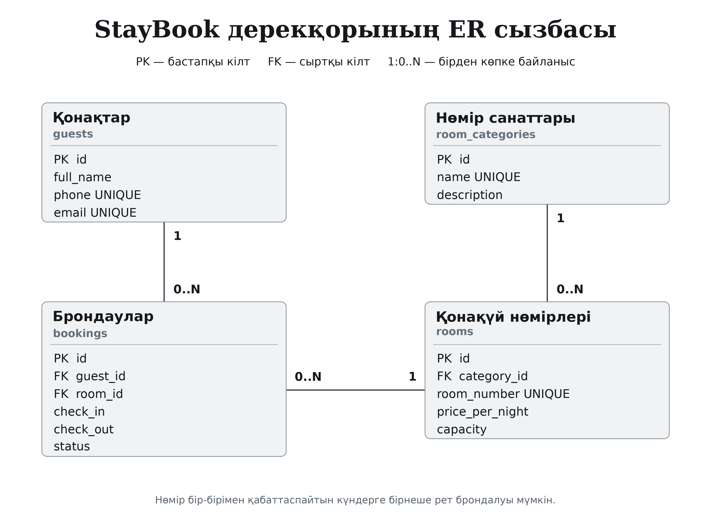

# StayBook — қонақүй нөмірлерін брондау жүйесі

Python тіліндегі қолданбалы ақпараттық жүйе. Жоба №1–4 зертханалық жұмыстарды бірізді қамтиды: архитектура мен Git → реляциялық база → REST API → CRUD, іздеу және сүзгілеу.

Нөмірлердің санатын, түндік бағасын және сыйымдылығын сақтауға, қонақтарды тіркеуге, брондауларды басқаруға арналған. Бір нөмірге мерзімдері қабаттасатын күшін жоймаған брондаулар қабылданбайды.

## Зертханалық жұмыстар

| Жұмыс | Мазмұны | Материал |
|---|---|---|
| №1 | ER-диаграмма, жоба құрылымы, Python ортасы, Git | [Орындау жолы](docs/lab_01.md) |
| №2 | SQLModel модельдері, байланыстар, SQLite, тестілік деректер | [Орындау жолы](docs/lab_02.md) |
| №3 | FastAPI, GET/POST, сессияға тәуелділік, Swagger | [Орындау жолы](docs/lab_03.md) |
| №4 | PATCH/DELETE, іздеу, баға бойынша сүзгілеу, қателерді өңдеу | [Орындау жолы](docs/lab_04.md) |

[Зертханалық жұмыстар есебі](docs/report.md) · [Қорғауға арналған 20 сұрақтың жауабы](docs/defense_questions.md)

## Дерекқор сызбасы



[SVG нұсқасы](docs/er_diagram.svg) · [draw.io арқылы өңдеу](docs/er_diagram.drawio)

| Кесте | Қызметі | Байланысы |
|---|---|---|
| `guests` | Қонақтың аты, телефоны және электрондық поштасы | Бір қонақ → бірнеше брондау |
| `room_categories` | Нөмір санатының атауы мен сипаттамасы | Бір санат → бірнеше нөмір |
| `rooms` | Нөмір белгісі, санаты, түндік бағасы, сыйымдылығы | Бір нөмір → әртүрлі күндердегі бірнеше брондау |
| `bookings` | Қонақ, нөмір, келу/кету күндері және мәртебе | Қонақ пен нөмірге сыртқы кілттер арқылы байланысады |

Сызбадағы `PK` — бастапқы кілт, `FK` — сыртқы кілт, `UNIQUE` — қайталанбайтын мән. `1 — 0..N` бір негізгі жазбаға нөл немесе бірнеше бағыныңқы жазба сәйкес келетінін білдіреді.

## Іске қосу

Python 3.11 немесе одан жаңа нұсқа және Git қажет. GitHub-тағы репозиторийдің **Code → HTTPS** сілтемесін көшіріп, жобаны жүктеңіз:

```bash
git clone <репозиторийдің_HTTPS_сілтемесі>
cd applied-is-project-2026
python -m venv venv
```

Ортаны белсендіру, Windows PowerShell:

```powershell
.\venv\Scripts\Activate.ps1
```

Windows CMD:

```bat
venv\Scripts\activate.bat
```

Linux/macOS:

```bash
source venv/bin/activate
```

Тәуелділіктерді орнатып, дерекқорды бастапқы деректермен толтырыңыз және API-ді іске қосыңыз:

```bash
python -m pip install -r requirements-dev.txt
python seed.py
uvicorn app.main:app --reload
```

Қолданбаға ғана қажет пакеттерді `python -m pip install -r requirements.txt` командасымен орнатуға болады. Тесттер үшін `requirements-dev.txt` қолданылады.

- API: <http://127.0.0.1:8000/>
- Swagger UI: <http://127.0.0.1:8000/docs>
- OpenAPI JSON: <http://127.0.0.1:8000/openapi.json>

Қосымша интерфейсті API жұмыс істеп тұрған кезде екінші терминалда іске қосыңыз. Сол терминалда да виртуалды ортаны белсендіріңіз:

```bash
streamlit run frontend/app.py
```

Streamlit әдетте <http://localhost:8501> мекенжайында ашылады. API-ге арналған терминалды ашық қалдырыңыз.

> GitHub кодты сақтайды. Репозиторийге жүктеу FastAPI серверін автоматты түрде іске қоспайды. Cursor немесе VS Code орнатып, жобаны өз компьютеріңізде ашу және қорғауда көрсету — студент орындайтын жергілікті қадам.

## API мысалдары

| Әдіс және жол | Мақсаты | Негізгі нәтиже |
|---|---|---|
| `GET /` | Сервердің жұмысын тексеру | `200` |
| `GET /rooms` | Нөмірлер тізімі, іздеу және сүзгілеу | `200` |
| `GET /rooms/{id}` | Бір нөмірді алу | `200` немесе `404` |
| `POST /rooms` | Нөмір қосу | `201` |
| `PATCH /rooms/{id}` | Тек жіберілген өрістерді өзгерту | `200` |
| `DELETE /rooms/{id}` | Брондаусыз нөмірді жою | `204`, жауап денесі жоқ |
| `GET /guests`, `POST /guests` | Қонақтарды көру және қосу | `200` / `201` |
| `GET /categories`, `POST /categories` | Санаттарды көру және қосу | `200` / `201` |
| `GET /bookings`, `POST /bookings` | Брондауларды көру және жасау | `200` / `201` |

Қонақтар, санаттар және брондаулар үшін де ID бойынша оқу, PATCH және DELETE әрекеттері бар. Толық схема Swagger ішінде беріледі. Тізімдерде `offset` және `limit` беттеу параметрлері қолданылады.

Іздеу мысалы:

```text
GET /rooms?search=10&min_price=10000&max_price=30000&category_id=1
```

Бір түннің бағасы теңгемен беріледі. `POST /rooms` сұрауының мысалы, мұндағы `category_id` базада болуы керек:

```json
{
  "category_id": 1,
  "room_number": "DEMO-601",
  "price_per_night": "22000.00",
  "capacity": 2
}
```

Бағаны ғана өзгерту:

```json
{
  "price_per_night": "24500.00"
}
```

Осы денені `PATCH /rooms/{id}` сұрауымен жіберіңіз. Тізімдегі басқа өрістер өзгермеуі керек.

## Тексеру

```bash
python -m pytest -q
```

Тесттер негізгі CRUD әрекеттерін, іздеу мен сүзгілерді, валидацияны және брондау қайшылықтарын тексеруге арналған. Нақты іске қосу нәтижелері [тексеру есебінде](docs/verification.md) беріледі.

Қолмен көрсетуге арналған қысқа сценарий:

1. `python seed.py` орындап, Swagger-де нөмірлер тізімін ашу.
2. Теріс бағамен `POST /rooms` жіберу: күтілетін жауап — `422`.
3. Бірегей нөмір белгісімен дұрыс жазба жасау: `201`.
4. `PATCH` арқылы тек бағасын өзгертіп, `GET` арқылы қалған өрістердің сақталғанын тексеру.
5. Іздеу мен баға аралығын қолданып тізімді сүзгілеу.
6. Жаңа нөмірді жойып, сол ID-ге қайта жүгіну: `404`.

## Файлдардың қызметі

```text
app/
  main.py            FastAPI қолданбасы және роутерлерді қосу
  models.py          SQLModel кестелері және Relationship байланыстары
  schemas.py         Сұрау/жауап пен жаңарту схемалары
  db.py              SQLite engine, init_db және get_session
  routers/           Нөмірлер, қонақтар, санаттар, брондаулар API-і
frontend/app.py      Қосымша Streamlit интерфейсі
seed.py             Бастапқы тестілік деректерді енгізу
requirements.txt    Қолданба пакеттері
requirements-dev.txt Тексеру мен құжат дайындау құралдары
tests/              API және бизнес ережелерін тексеру
docs/               Сызба, жұмыстардың сипаттамасы және есеп
scripts/            Сызба мен қосымша материалдарды жасау құралдары
```

`database.db` және `venv/` репозиторийге кірмейді: база `python seed.py` арқылы қайта жасалады, ал орта тәуелділіктер тізімінен орнатылады. Құпия мәндер `.env` сияқты жергілікті конфигурацияда сақталып, Git-ке қосылмайды.

Қалыпты қосылым — `sqlite:///./database.db`. Өзге жол үшін `DATABASE_URL` орта айнымалысын беруге болады. SQL сұрауларын көру үшін `SQL_ECHO=1` қолданылады. `.env.example` — мысал ғана: `.env` файлы автоматты оқылмайды, айнымалыларды терминал не IDE ортасына енгізу керек. Демонстрациялық жоба аутентификациясыз жергілікті оқу ортасына арналған; жария серверге орналастыру алдында пайдаланушы құқықтары мен орналастыру конфигурациясы бөлек дайындалады.
