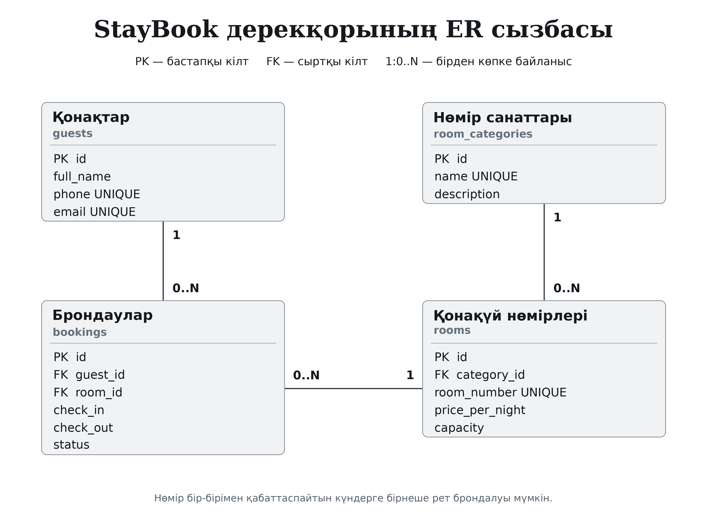

# Зертханалық жұмыс №1

**Тақырып:** ақпараттық жүйені жобалау, ИИ көмегімен әзірлеу ортасын және нұсқаларды басқаруды дайындау.

**Жоба:** StayBook — қонақүй нөмірлерін брондау жүйесі.

## Мақсат

Пәндік саланы кестелерге бөлу, ER-диаграмма құру, Python жобасының құрылымын дайындау және Git арқылы өзгерістерді сақтау тәртібін түсіну.

## 1. Пәндік саланы анықтау

Қонақүй қызметкері қонақтарды, нөмір санаттарын, нөмірлердің бағасы мен сыйымдылығын және брондауларды есепке алады. Нөмір бірнеше рет брондалуы мүмкін, бірақ күшін жоймаған брондаулардың күндері қабаттаспайды.

Төрт негізгі мән таңдалды:

- `guests` — қонақтар;
- `room_categories` — нөмір санаттары;
- `rooms` — қонақүй нөмірлері;
- `bookings` — брондаулар.

Байланыстар: `room_categories → rooms`, `guests → bookings`, `rooms → bookings`. Барлығы — «бірден көпке»: `1 — 0..N`.

## 2. ER-диаграмма



Сызбадағы кестелердің қазақша тақырыбы, ағылшынша техникалық атауы және өрістері көрсетілген. `PK id` әр жазбаны анықтайды. `FK category_id`, `FK guest_id`, `FK room_id` кестелерді байланыстырады.

Тапсырылатын файлдар: `er_diagram.png`, масштабталатын `er_diagram.svg` және draw.io ішінде өңделетін `er_diagram.drawio`.

## 3. Git репозиторийі

Қашықтағы ашық репозиторий: [kasanovaaruzan74-oss/StayBook](https://github.com/kasanovaaruzan74-oss/StayBook). Негізгі сипаттама `README.md` файлында беріледі, Python ортасы мен уақытша файлдар `.gitignore` арқылы алынып тасталады.

Жергілікті жүктеу:

```bash
git clone https://github.com/kasanovaaruzan74-oss/StayBook.git
cd StayBook
```

Қолданыстағы `StayBook` репозиторийі пайдаланылады. Нұсқаулықтағы `applied-is-project-2026` — атау стилінің мысалы; бұл жобаның нақты атауы — `StayBook`.

## 4. Жергілікті IDE және орта

Студент өз компьютеріне Cursor немесе VS Code және ИИ көмекшісін орнатады, жоба папкасын ашады. IDE орнату студенттің компьютерінде орындалатын қадам; репозиторийдегі код бұл орнатуды алмастырмайды.

```bash
python -m venv venv
```

Windows PowerShell: `.\venv\Scripts\Activate.ps1`.
Linux/macOS: `source venv/bin/activate`.

```bash
python -m pip install -r requirements-dev.txt
```

ИИ-ге беруге болатын сұрау үлгісі:

> Python тілінде қонақүй нөмірлерін брондау жүйесін жасаймын. FastAPI сервері, SQLModel дерекқоры және Streamlit интерфейсі үшін түсінікті папка құрылымын ұсын. fastapi, uvicorn, sqlmodel, streamlit тәуелділіктерін көрсет. Әр файлдың міндетін түсіндір.

Жобада `app/database/`, `app/routers/`, `app/frontend/`, `tests/`, `docs/`, `scripts/` бөлімдері қарастырылған. Толық қызметтер кейінгі зертханаларда осы құрылымға қосылады.

## 5. Өзгерістерді сақтау

```bash
git add README.md .gitignore requirements.txt requirements-dev.txt app frontend docs scripts
git commit -m "feat: initial project structure with AI assist"
git push origin main
```

Командалар орындау тәртібін көрсетеді. Алдын ала жасалған коммиттерді қайталау қажет емес; нақты тарих `git log --oneline` арқылы қаралады.

## Қорғауда көрсету

ER-диаграммадағы үш байланысты түсіндіру, виртуалды ортаны белсендіру, `.gitignore` және README файлын ашу. Қорытынды бақылау сұрақтарының жауаптары [осында](defense_questions.md#зертханалық-жұмыс-1).
