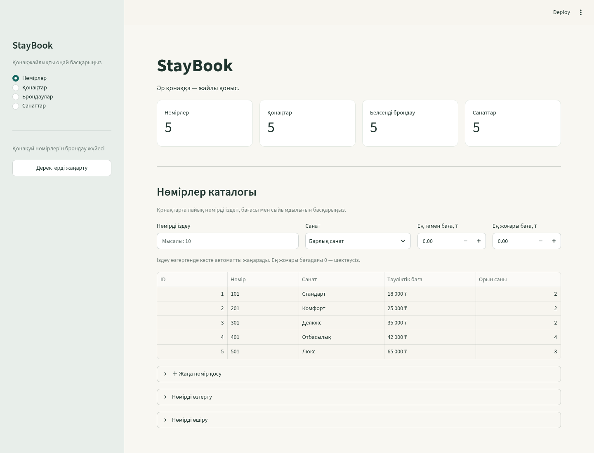
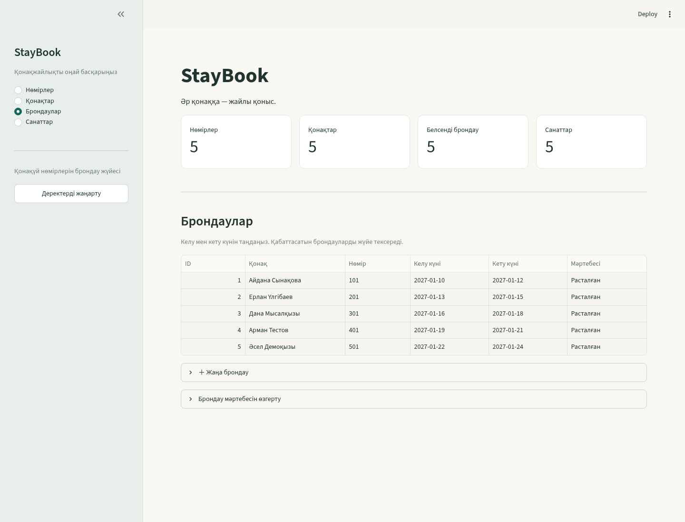

# Зертханалық жұмыс №5

**Тақырып:** Streamlit арқылы пайдаланушы веб-интерфейсін жасау.

## Мақсат

№1–4 жұмыстарда дайындалған FastAPI серверіне HTTP сұраулар жіберетін интерфейс құру: мәліметті кестемен көрсету, динамикалық іздеу, жазба қосу және өшіру.

## 1. Интерфейс файлы және іске қосу

Негізгі файл — `app/frontend/ui.py`. Алдымен жоба түбірінде белсенді виртуалды ортамен деректерді дайындап, API-ді іске қосыңыз:

```bash
python seed.py --if-empty
uvicorn app.main:app --reload
```

Екінші терминалда сол ортаны белсендіріп:

```bash
streamlit run app/frontend/ui.py
```

Интерфейс: <http://localhost:8501>. Бірінші терминалды жаппаңыз. Бұрынғы `streamlit run frontend/app.py` командасы үйлесімділік файлы арқылы сол қолданбаны іске қосады.

ИИ сұрауының үлгісі:

> StayBook қонақүй брондау жүйесі үшін Streamlit интерфейсін жаса. Бет тақырыбы мен sidebar қос, API күйін көрсет. Нөмірлер, брондаулар, қонақтар мен санаттарды бөлек бөлімдерге бөл. API-ге requests арқылы қатына.

## 2. Requests арқылы деректерді алу

`requests.get(...)` API-ден JSON деректерін алады. Нөмірлер тізімі `/rooms`, санаттар `/categories`, қонақтар `/guests`, брондаулар `/bookings` арқылы сұралады. Тізім `st.dataframe` кестесінде көрсетіледі.

API адресі орта айнымалысынан алынады:

```python
BASE_URL = os.getenv("BACKEND_URL", "http://127.0.0.1:8000")
```

Жергілікті ортада әдепкі мән жеткілікті, Docker ішінде `BACKEND_URL=http://backend:8000` беріледі. UI дерекқорға тікелей қосылмайды: барлық дерек әрекеттері API арқылы өтеді.

Сұрауларда күту уақытының шегі беріледі. Сервер қолжетімсіз болғанда интерфейс байланыс қатесін түсінікті хабарламамен көрсетеді. HTTP `404`, `409`, `422` сияқты жауаптардағы backend түсіндірмесі пайдаланушыға жеткізіледі.

## 3. Динамикалық іздеу және сүзгілер

Нөмір белгісін іздеу үшін `st.text_input` қолданылады. Іздеу виджеті дерек қосу формасынан тыс орналасады: пайдаланушы өзгерткен мән Streamlit-ке жіберілгенде скрипт қайта орындалып, жаңа `search` параметрімен GET сұрауы жасалады. Бөлек «іздеуді қолдану» формасын жіберу талап етілмейді.

Мысал сұрау:

```python
requests.get(
    f"{BASE_URL}/rooms",
    params={"search": search_query, "min_price": min_price},
    timeout=10,
)
```

`params` URL-дегі query параметрлерін кодтайды. Нөмірдің толық мазмұнын жібермей, тізімге арналған шарттар ғана беріледі. Санат пен баға шектері де №4 жұмыстың API сүзгілерін қолданады.

## 4. Қосу, өзгерту және жою

Жаңа нөмір қосу формасы `st.form` арқылы беріледі. Пайдаланушы нөмір белгісін, санатын, бағасын және сыйымдылығын таңдайды. Сақтау батырмасы:

1. `POST /rooms` сұрауын `json=...` денесімен жібереді.
2. Сервердің валидация нәтижесін қарайды.
3. Сәтті болса `st.success` хабарламасын көрсетіп, мәліметті қайта жүктейді.

Жою таңдалған жазбаның ID-імен `DELETE` сұрауы арқылы орындалады. Қонақүй нөмірінің байланысқан брондауы болса, сервер оны жоюға жол бермейді. PATCH арқылы өзгерту де UI-ден қолжетімді.

ИИ сұрауының үлгісі:

> Нөмір қосатын st.form жаса: room_number, category_id, price_per_night, capacity. Сақтағанда requests.post(..., json=payload) шақыр. Қате жауапты көрсет, ал сәтті қосылғанда тізімді жаңарт. Таңдалған нөмірді өшіру және тек өзгерген өрістерін PATCH арқылы сақтау мүмкіндігін қос.

## 5. Қолмен тексеру

1. UI-де бастапқы нөмірлердің көрінуін тексеріңіз.
2. Нөмір белгісінің бір бөлігін енгізіп, сәйкес жолдарды қараңыз.
3. Баға шектерін және санатты өзгертіңіз.
4. Seed ішінде жоқ `DEMO-601` сияқты белгімен жаңа нөмір қосыңыз.
5. Оның бағасын өзгертіп, кейін брондаусыз жазбаны жойыңыз.
6. API-ді уақытша тоқтатып, UI-дегі байланыс қатесі хабарламасын тексеріңіз; кейін серверді қайта іске қосыңыз.





Нақты орындалған сценарийлер мен нәтижелер [verification.md](verification.md) файлында беріледі.

## Git-те сақтау

```bash
git add app/frontend/ frontend/ requirements.txt
git commit -m "feat: design interactive web UI using Streamlit integrated with FastAPI"
git push origin main
```

Бақылау сұрақтарының бес жауабы [осында](defense_questions.md#зертханалық-жұмыс-5). Бастапқы құжатта осы жұмыстың соңғы екі сұрағы №6 жұмыстан кейін орналасқан; жауаптар тақырыбына сәйкес біріктірілді.
