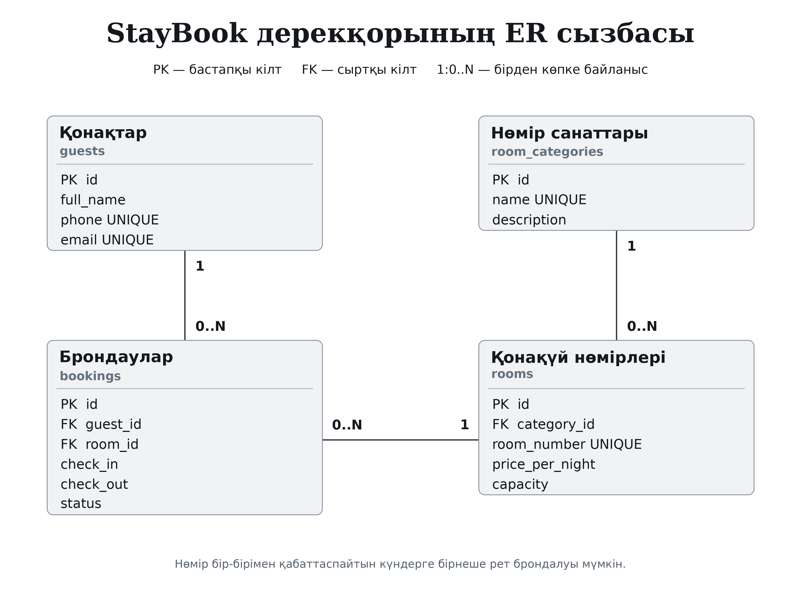
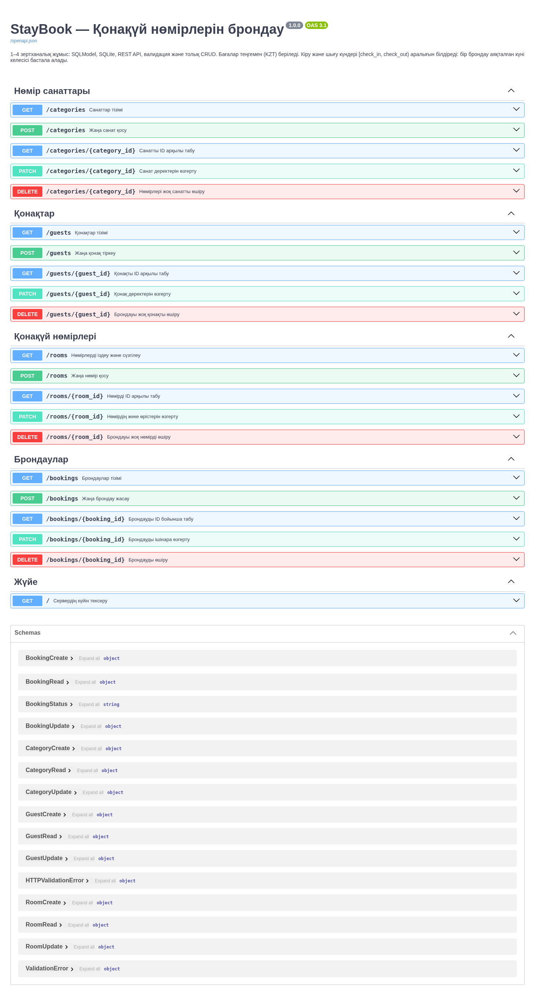
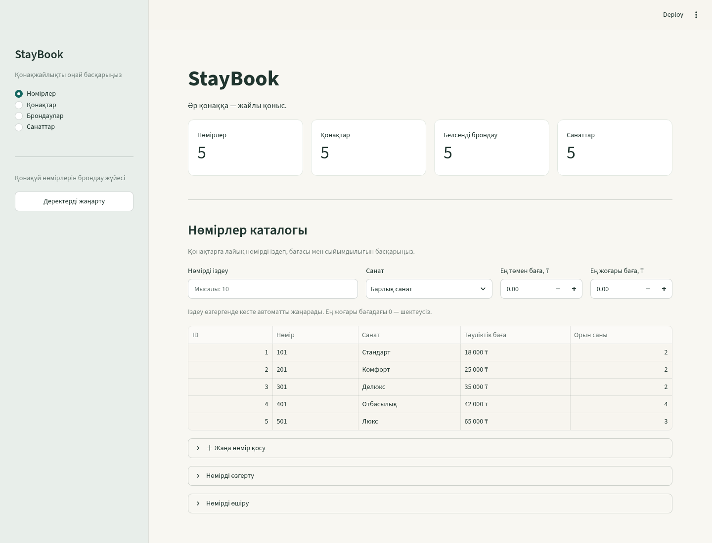
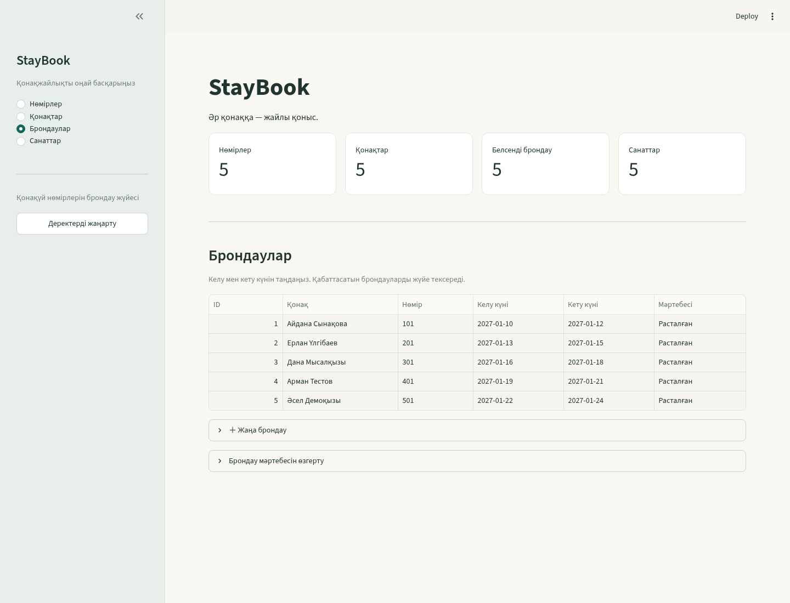

# №1–7 зертханалық жұмыстар бойынша есеп

**Пән:** Прикладное программное обеспечение информационных систем (2026 г.)

**Жоба:** StayBook — қонақүй нөмірлерін брондау жүйесі

**Орындаған студент:** Касанова Аружан

**Топ:** Ис-24а

**Тексерген оқытушы:** ____________________

**Тапсыру күні:** ____________________

**Репозиторий:** https://github.com/kasanovaaruzan74-oss/StayBook

## Жобаның мақсаты және пәндік сала

StayBook қонақүйдегі нөмірлер, олардың санаттары, қонақтар мен брондаулар туралы мәліметті бір жүйеде сақтайды. Жүйені қонақүй әкімшісі пайдаланады. Деректерді қосу, оқу, өзгерту, жою және сүзгілеу операциялары API мен веб-интерфейс арқылы орындалады. Нөмірді брондау кезінде күндердің дұрыстығы, байланысты жазбалардың бар болуы және мерзімдердің қабаттаспайтыны тексеріледі.

Жеті зертхана бір жобаның кезеңдері ретінде орындалады: архитектура → база → API → толық бизнес логика → веб-интерфейс → контейнерлер → автоматты тесттер және қорғау.

## Қолданылған құралдар

| Құрал | Міндеті |
|---|---|
| Python 3.11+ | Негізгі бағдарламалау тілі |
| FastAPI, Uvicorn | HTTP маршруттары және ASGI сервері |
| SQLModel, SQLAlchemy | ORM кестелері, байланыстар, транзакциялар |
| SQLite | Жергілікті реляциялық дерекқор |
| Pydantic | Сұрау және жауап схемалары, валидация |
| Streamlit, Requests | Веб-интерфейс және API-мен HTTP/JSON байланысы |
| Docker, Docker Compose | Екі компонентті контейнерлеу, ортақ желі және volume |
| Pytest, TestClient, HTTPX | API мен бизнес шарттарын автоматты тексеру |
| Git, GitHub | Нұсқалар тарихы және қашықтағы репозиторий |
| Codex ИИ көмекшісі | Құрылым, код, тест сценарийлерін дайындау және код ревьюі |

## №1. Ақпараттық жүйені жобалау және орта

Пәндік сала ретінде қонақүй нөмірлерін брондау таңдалды. Басты әрекеттер: қонақты тіркеу, санат пен нөмірді қосу, баға және сыйымдылықты сақтау, келу/кету мерзіміне брондау жасау.

Төрт кесте жобаланды:

1. `guests` — қонақтың аты-жөні, бірегей телефон нөмірі және электрондық поштасы.
2. `room_categories` — нөмір санаты мен оның сипаттамасы.
3. `rooms` — санатқа тиесілі нөмір, түндік баға және сыйымдылық.
4. `bookings` — қонақ пен нөмірге сілтемелер, келу/кету күндері және мәртебе.



**1-сурет — ER-диаграмма.** Бастапқы кілт `PK`, сыртқы кілт `FK`, бірегей өріс `UNIQUE` арқылы белгіленген. Бір санатқа бірнеше нөмір, бір қонаққа бірнеше брондау және бір нөмірге әртүрлі күндердегі бірнеше брондау сәйкес келеді.

Сызба PNG және SVG форматында, өңдеуге арналған draw.io нұсқасымен бірге берілді. Жоба `app/database/`, `app/routers/`, `app/frontend/`, `tests/`, `docs/` және `scripts/` бөлімдеріне бөлінді. Тәуелділіктер файлдары, README мен `.gitignore` дайындалды.

Жергілікті орта `python -m venv venv` арқылы құрылады. Cursor/VS Code орнату мен ИИ кеңейткішін баптау студенттің өз компьютерінде жасалады; README-де жүктеу, ортаны белсендіру және іске қосу қадамдары берілген.

## №2. Реляциялық база және ORM

ER-сызба `app/database/models.py` файлындағы SQLModel кластарына көшірілді. Модельдер бастапқы және сыртқы кілттерді, бірегей мәндерді және `Relationship` байланыстарын сипаттайды. Баға `Decimal`, брондау күндері `date` типімен беріледі.

`app/database/db.py` engine-ді, кестелерді дайындайтын `init_db()` және сұрауға сессия беретін `get_session()` функцияларын қамтиды. SQLite сыртқы кілттерді тексереді. Жергілікті базаның әдепкі файлы — `database.db`. Бұрынғы импорттар үшін `app/db.py` және `app/models.py` үйлесімділік модульдері сақталған.

`seed.py` скрипті әр кестеге 5 мысал жазбадан енгізуге арналған. Бірдей деректерді қайталап қоспау үшін табиғи бірегей мәндер тексеріледі:

```bash
python seed.py
```

Бұл команда жаңа базаға бастапқы деректер енгізуге арналған. Кейінгі іске қосуларда деректері бар базаны қозғамау үшін `python seed.py --if-empty` қолданылады.

`database.db`, виртуалды орта, кэштер мен құпия конфигурациялар Git-ке қосылмайды. Қайта қалпына келтіруге қажет модельдер мен seed коды репозиторийде сақталады.

## №3. FastAPI сервері және GET/POST

Қолданбаның кіру нүктесі — `app/main.py`. Сервер:

```bash
uvicorn app.main:app --reload
```

Жүйеде нөмірлер, қонақтар, санаттар және брондаулар үшін маршруттар бар. №3 жұмыстың негізгі әрекеттері — нөмірлер тізімін оқу, ID арқылы табу және жаңа нөмір қосу. Әр сұрау `Depends(get_session)` арқылы өз дерекқор сессиясын алады.

Сұрау схемалары ORM кестелерінен бөлінген. Нөмір қосқанда баға, бос белгі, санаттың бар болуы және сыйымдылық тексеріледі. Сәтті жасау `201`, жарамсыз дерек `422`, табылмаған ID `404`, қайталанатын бірегей мән `409` мәртебесімен беріледі.

Swagger UI мекенжайы — <http://localhost:8000/docs>. Құжаттама маршруттар мен схемалардан автоматты жасалады.



**2-сурет — API-дің Swagger UI көрінісі.** Орындалған нақты сұраулар мен тексерулер бөлек тексеру есебінде тіркеледі.

## №4. Толық CRUD және бизнес логика

`PATCH /rooms/{room_id}` тек жіберілген өрістерді өзгертеді. `model_dump(exclude_unset=True)` жіберілмеген өрістерді сақтайды, ал міндетті өріске нақты `null` жіберу валидациямен қабылданбайды.

`DELETE /rooms/{room_id}` нөмірдің бар болуын және байланысты брондауларын тексереді. Сәтті жою `204` бос жауабын береді. Жазба жоқ болса `404`, байланысты деректі бұзатын әрекет болса `409` қайтарылады.

Тізімді сүзгілеу query параметрлерімен беріледі:

```text
GET /rooms?search=10&min_price=10000&max_price=30000&category_id=1
```

SQL сұраулары SQLModel конструкцияларымен жасалады; пайдаланушы енгізуі SQL мәтініне тікелей жалғанбайды. Төменгі және жоғарғы баға шектері тексеріледі.

Брондауда `check_out` күні `check_in` күнінен кейін болуы керек. Қонақ пен нөмір базада болуы тиіс. Бір нөмірге қабаттасатын, күшін жоймаған брондау қабылданбайды. `[check_in, check_out)` интервалы бойынша бір қонақтың шығу күні келесісінің келу күнімен сәйкес келуі мүмкін.

## №5. Streamlit веб-интерфейсі

Негізгі интерфейс — `app/frontend/ui.py`. API жұмыс істеп тұрған кезде екінші терминалда:

```bash
streamlit run app/frontend/ui.py
```

Браузерде <http://localhost:8501> ашылады. UI қонақүй нөмірлерін, брондауларды, қонақтарды және санаттарды көрсетеді. `Requests` кітапханасы API-ге HTTP/JSON арқылы қатынасады. Іздеу мен баға шарттары GET сұрауының `params` параметрімен, жаңа жазба өрістері POST сұрауының `json` денесімен жіберіледі.

Іздеу виджетінің мәні өзгеріп, Streamlit-ке жіберілгенде скрипт қайта орындалып, тізім жаңа шартпен жүктеледі. Қосу формалары, өзгерту және жою әрекеттері сервердің CRUD маршруттарын пайдаланады. Сәтті әрекет туралы хабарлама мен сервер қатесінің түсіндірмесі интерфейсте көрсетіледі.



**3-сурет — нөмірлер тізімі және пайдаланушы әрекеттері.** UI дерекқорды тікелей ашпайды; дерек өзгерісі FastAPI арқылы өтеді.



**4-сурет — брондаулар бөлімі.** `BACKEND_URL` орта айнымалысы API адресін анықтайды, әдепкісі — `http://127.0.0.1:8000`. Бұрынғы `frontend/app.py` іске қосу файлы үйлесімділік үшін сақталған.

## №6. Docker және Docker Compose

`Dockerfile` FastAPI-ді, `Dockerfile.frontend` Streamlit-ті бөлек образдарға жинайды. Тәуелділіктер кодтан бұрын орнатылады, бұл құрастыру кэшін пайдалануға мүмкіндік береді. `.dockerignore` жергілікті орта, база, кэш және қажетсіз файлдарды образға қоспайды.

`docker-compose.yml` екі сервисті байланыстырады:

| Сервис | Мақсаты | Байланыс |
|---|---|---|
| `backend` | API, SQLite, бастапқы деректер | Хост `8000` → контейнер `8000` |
| `frontend` | Веб-интерфейс | Хост `8501` → контейнер `8501` |

Frontend контейнерінде `BACKEND_URL=http://backend:8000` беріледі. Compose желісінің ішкі DNS жүйесі `backend` атын тиісті контейнер адресіне сәйкестендіреді. `depends_on` және healthcheck backend дайын болғаннан кейін UI-ді бастауға мүмкіндік береді.

SQLite `/data/database.db` ішінде, тұрақты named volume-да сақталады. Контейнер іске қосылғанда `python seed.py --if-empty` төрт кесте де бос болса ғана мысал деректерді енгізеді. Қайта іске қосу бұрынғы бизнес деректерін өзгертпейді және жойылған мысалдарды өздігінен қалпына келтірмейді.

Іске қосу:

```bash
git clone https://github.com/kasanovaaruzan74-oss/StayBook.git
cd StayBook
docker compose up --build
```

Алдын ала Docker Desktop іске қосылып, `8000` және `8501` порттары бос болуы керек. Қалыпты `docker compose down` volume-ды сақтайды. Деректерді сақтау қажет кезде `down -v` қолданылмайды.

## №7. Автоматты тесттер және қорғау

`tests/` ішінде Pytest және FastAPI TestClient қолданатын API сценарийлері берілген. Негізгі талаптар — GET `200` және жарамды POST `201`. Қосымша сценарийлер CRUD, валидация, іздеу, бірегей мәндер, сыртқы кілттер, жою шектеулері және брондау қайшылықтарын қамтиды.

Тесттер бөлек тестілік дерекқорды қолданады. TestClient сұраулары үшін Uvicorn-ды жеке іске қосу қажет емес:

```bash
python -m pip install -r requirements-dev.txt
pytest
```

Кодты тексеруде сессиялардың жабылуы, қате транзакцияны rollback жасау, параметрленген SQL шарттары, PATCH null валидациясы және брондаулардың қатар жазылуы қарастырылады. ИИ ұсынған код нақты логика және тест нәтижесімен тексеріледі.

README нұсқаулықтағы бес міндетті бөлімге сәйкес толтырылды. Әр зертханаға жеке түсіндірме және барлығы 35 бақылау сұрағының жауабы берілген. Автор мен топ көрсетілді; оқытушы мен тапсыру күніне арналған орындар сақталды.

## Тексеру жағдайлары және нақты нәтижелер

Кесте күтілетін мінез-құлықты сипаттайды. Нақты тест саны, орындалған браузер сұраулары және Docker тексеруінің қорытындысы [verification.md](verification.md) файлында беріледі.

| Әрекет | Күтілетін нәтиже |
|---|---|
| Нөмірлер тізімін алу | `200`, тізім |
| Жарамды нөмір қосу | `201`, жасалған жазба |
| Теріс бағамен нөмір қосу | `422` |
| Бағаны PATCH арқылы өзгерту | `200`, басқа өрістер сақталады |
| Нөмір белгісі және баға бойынша сүзгілеу | Шартқа сәйкес жазбалар |
| Брондаусыз нөмірді жою | `204`, бос жауап |
| Жойылған ID-ге қайта жүгіну | `404` |
| Бірегей нөмір белгісін қайталау | `409` |
| Мерзімі қабаттасатын брондау | `409` |
| База толы кезде автоматты seed | Бұрынғы деректер өзгермейді |
| UI іздеу және форма жіберу | API арқылы жаңарған кесте |
| Compose арқылы екі сервис | UI және Swagger қолжетімді |
| Қалыпты down/up | Volume-дағы деректер сақталады |

## Git тарихы

Зертхана кезеңдерінің коммит тақырыптары:

```text
feat: initial project structure with AI assist
feat: add SQLModel ORM models and database seed script
feat: implement FastAPI endpoints for GET and POST with validation
feat: complete CRUD operations with PATCH, DELETE and query filtering
feat: design interactive web UI using Streamlit integrated with FastAPI
chore: containerize application with Docker and Docker Compose
test: add integration tests and final documentation update
```

Нақты тарих `git log --oneline` арқылы қаралады. Коммиттер өздерінің нақты уақытын сақтайды. GitHub код пен құжаттарды сақтайды; веб-сервистер Docker не жергілікті Python командаларымен іске қосылады.

## Қорғау реті

1. ER-сызбаны және кестелер арасындағы үш байланысты түсіндіру.
2. `docker compose up --build` арқылы жүйені қосып, сервис күйін көрсету.
3. UI-де іздеу, нөмір қосу, бағасын өзгерту және жоюды көрсету.
4. Қайшы брондау, теріс баға және жоқ ID жауаптарын түсіндіру.
5. Swagger-ді ашып, HTTP әдістері мен жауап схемаларын көрсету.
6. `pytest` орындап, нақты нәтижені қарау.
7. Негізгі файлдардың міндетін және Git тарихындағы кезеңдерді түсіндіру.

Бақылау сұрақтарының жауаптары: [defense_questions.md](defense_questions.md). Әр жұмыстың толық орындау жолы: `lab_01.md`–`lab_07.md`.
